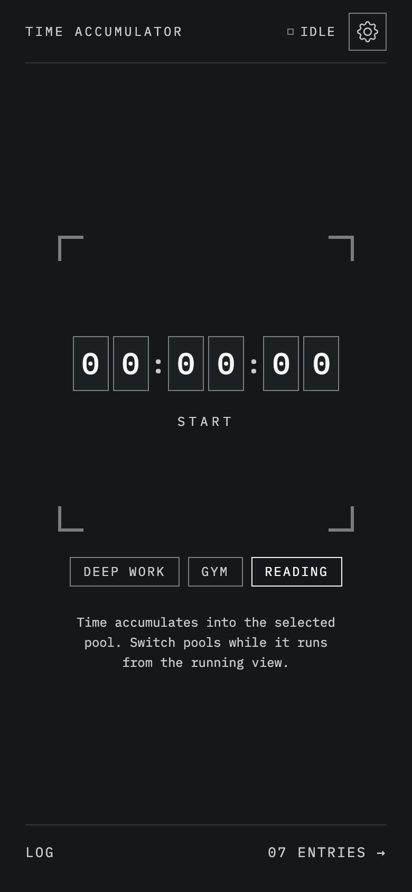
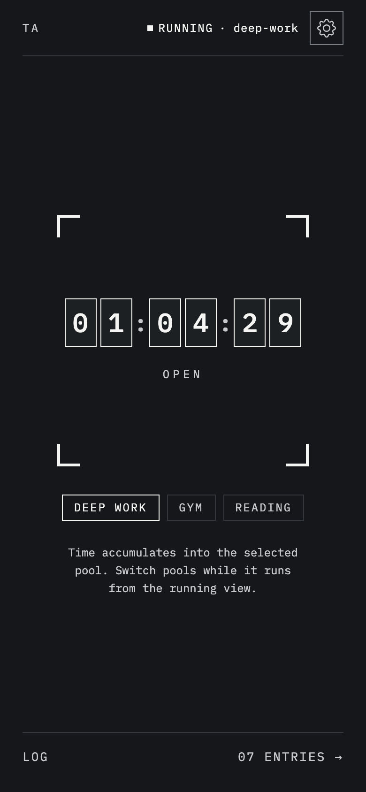
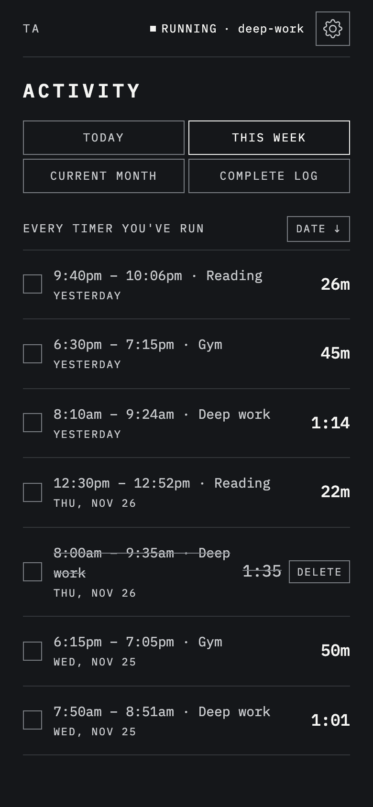
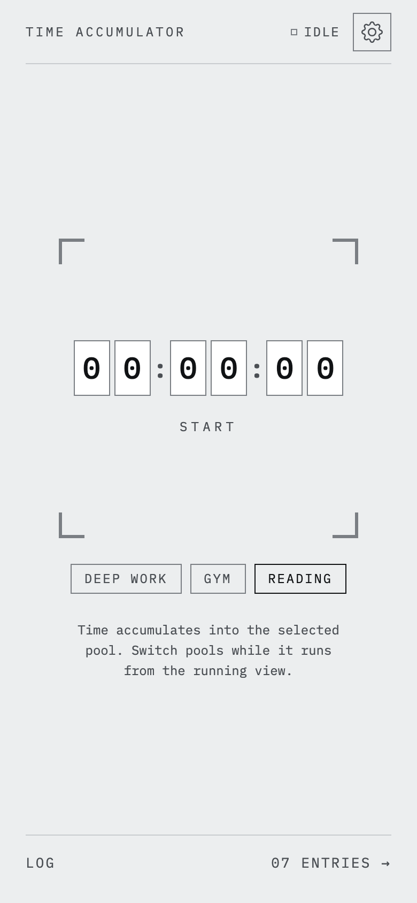
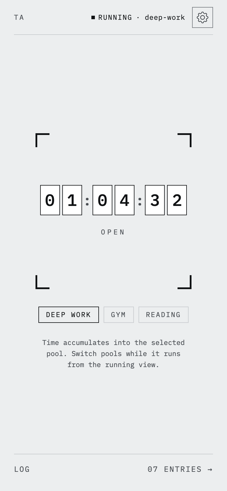
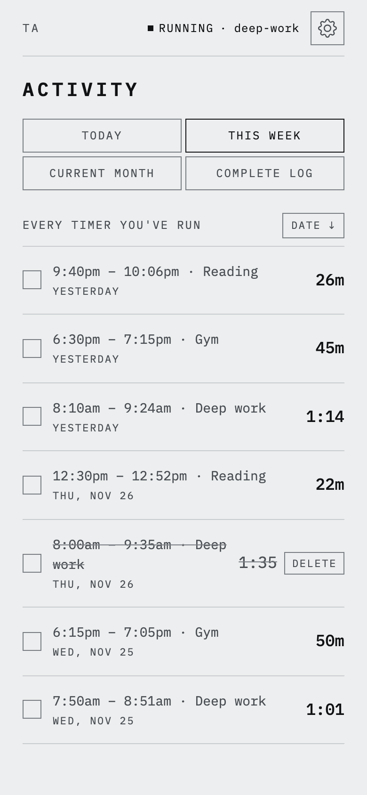

<div align="center">

<picture>
  <source media="(prefers-color-scheme: dark)" srcset="docs/brand/icon.svg">
  <source media="(prefers-color-scheme: light)" srcset="docs/brand/icon-light.svg">
  
</picture>

# Time Accumulator

Toggle time on and off and accumulate it into pools.

[](https://github.com/cowglow/time-accumulator/actions/workflows/deploy.yml)
[](https://cowglow.github.io/time-accumulator/)
[](https://github.com/cowglow/time-accumulator/releases)
[](LICENSE)
[](package.json)
[](package.json)

**[cowglow.github.io/time-accumulator](https://cowglow.github.io/time-accumulator/)**





<details>
<summary>Light theme</summary>
<br>



</details>

</div>

## Features

- **One-tap timer.** The whole bracket-framed readout is the start button.
  While a timer runs, tapping it opens a full-screen running view with Stop.
- **Pools.** Every timer accumulates into a pool (Deep work, Gym, …). A
  first-run setup asks for the first pool; you can switch the running timer
  to another pool without stopping it.
- **Activity log.** Every completed run with its start–end time and duration,
  filtered by Today, This week, Current month or Complete log, sorted by date
  in either direction.
- **Bulk editing.** Select entries to tag them with a pool or omit them from
  totals; omitted entries can be restored or deleted.
- **Totals per pool** for each range, with a bar comparing pools.
- **Survives reloads.** Pools, entries and the running timer are kept in
  `localStorage`; a running timer keeps counting from its original start.
- **Export.** Download the complete log or a single pool as CSV, or open it as
  JSON in the browser at `/pool/json` and `/pool/{slug}/json`.
- **Real URLs.** `/activity`, `/pool` and `/pool/{slug}` deep-link and work
  with the browser's back and forward buttons.
- **Dark and light themes** that follow the system setting, and motion that
  switches off under `prefers-reduced-motion`.
- **Installable** web app manifest and icons for adding to a home screen.

All data stays in the browser it was recorded in; there is no server.

## Getting started

Requires Node.js **24** (pinned in [`.nvmrc`](.nvmrc)).

```sh
nvm use          # or install Node 24 another way
npm install
npm run dev      # http://localhost:5173/time-accumulator/
```

## Scripts

| Script               | Command                       |
| -------------------- | ----------------------------- |
| `npm run dev`        | `vite`                        |
| `npm run build`      | `tsc --noEmit && vite build`  |
| `npm run preview`    | `vite preview`                |
| `npm test`           | `vitest run`                  |
| `npm run test:watch` | `vitest`                      |
| `npm run predeploy`  | `npm run build`               |
| `npm run deploy`     | `gh-pages -d dist`            |

Pushes to `master` are tested, built and deployed to GitHub Pages by
[`.github/workflows/deploy.yml`](.github/workflows/deploy.yml).

## Tech stack

- [React](https://react.dev/) 19 and TypeScript
- [Vite](https://vite.dev/) for dev server and build
- [Vitest](https://vitest.dev/) with jsdom for tests
- Plain CSS with custom properties: no CSS framework, no CSS-in-JS
- Native `Date`/`Intl` for all date and duration maths: no date library
- IBM Plex Mono, self-hosted
- GitHub Actions and GitHub Pages

## Project structure

```text
.
├── .github/workflows/   deploy.yml (test, build, Pages) and release.yml (tagged releases)
├── docs/
│   ├── architecture.md  domain model, state, routing, export
│   ├── testing.md       how the test suite is set up and what it covers
│   ├── brand/           logo, social preview, BRAND.md
│   └── screenshots/     images used in this README
├── public/              icons, manifest, global stylesheets, self-hosted fonts
├── src/
│   ├── components/      one .tsx + .css per component; App.tsx routes between views
│   ├── contexts/        AppStateContext (pools, entries, running timer), RouterContext (URLs)
│   ├── hooks/           useTimer, useLocalStorage, useEntrySelection
│   ├── lib/             pure logic: date ranges, slugs, routes, export, sorting, formatting
│   ├── test/            Vitest setup and a renderHook helper
│   ├── types/           global domain types (Pool, TimeEntry, RunningTimer)
│   └── index.tsx        entry point
├── index.html
└── vite.config.ts       base path, plugins, the 404.html fallback for GitHub Pages
```

## Architecture and testing

State lives in two React contexts. `AppStateContext` holds the pools, the
time entries and the running timer, persists each to `localStorage`, and
exposes the actions that change them. `RouterContext` maps the URL to a view
using the History API. GitHub Pages has no server-side routing, so the build
copies `index.html` to `404.html` and the app reads the route from the path.
`useTimer` recomputes the elapsed time from the stored start timestamp rather
than counting ticks, which is why a reload or a backgrounded tab never loses
time.

Tests are Vitest unit tests for the hooks, the context and the `lib/` logic,
plus app-level tests that render the whole app in jsdom to cover onboarding,
routing, export and the selection footer. Run them with `npm test`.

More detail in [`docs/architecture.md`](docs/architecture.md) and
[`docs/testing.md`](docs/testing.md).

## Design

Monochrome, square and monospace, with bracket framing instead of rounded UI.
Colours are six CSS custom properties, with a light set that takes over under
`prefers-color-scheme: light`:

| Token         | Dark      | Light     | Role                                         |
| ------------- | --------- | --------- | -------------------------------------------- |
| `--bg`        | `#15171a` | `#eceeef` | page background                              |
| `--panel`     | `#1d2023` | `#ffffff` | digit tiles and panels                       |
| `--hairline`  | `#33363a` | `#c9cccf` | decorative dividers, never text              |
| `--structure` | `#797d82` | `#7a7e83` | idle brackets and borders, never text        |
| `--primary`   | `#f5f5f3` | `#101214` | the one value that matters most in a context |
| `--secondary` | `#c7c9cc` | `#4b4f54` | all other text                               |

Only two text tones exist: `--primary` and `--secondary`. `--structure` and
`--hairline` are reserved for borders and dividers, so every text colour stays
at or above about 4.5:1 contrast against the background and every structural
element at or above about 3:1.

The mark is a square bracket frame around three colons. See
[`docs/brand/BRAND.md`](docs/brand/BRAND.md) for the brand assets.

## Releases and versioning

Versions follow [Semantic Versioning](https://semver.org/), and every release
is an annotated `v*.*.*` git tag. Changes are recorded in
[`CHANGELOG.md`](CHANGELOG.md). Commits follow
[Conventional Commits](https://www.conventionalcommits.org/) from here on.

Add an entry under `## [Unreleased]` in `CHANGELOG.md` as changes land. To
cut a release:

1. In `CHANGELOG.md`, add a heading for the new version under
   `## [Unreleased]`, so the pending entries move under it and Unreleased
   is left empty:

   ```md
   ## [Unreleased]

   ## [X.Y.Z] - YYYY-MM-DD
   ```

   At the bottom of the file, point `[Unreleased]` at the new tag and add a
   compare link for the new version:

   ```md
   [Unreleased]: https://github.com/cowglow/time-accumulator/compare/vX.Y.Z...HEAD
   [X.Y.Z]: https://github.com/cowglow/time-accumulator/compare/vPREVIOUS...vX.Y.Z
   ```

2. Bump the version, then commit, tag and push everything together:

   ```sh
   npm version <patch|minor|major> --no-git-tag-version   # package.json + lockfile only
   git add CHANGELOG.md package.json package-lock.json
   git commit -m "chore(release): vX.Y.Z"
   git tag -a vX.Y.Z -m "vX.Y.Z"
   git push --follow-tags
   ```

   `--no-git-tag-version` is needed because plain `npm version` refuses to
   run with uncommitted changes, and the dated changelog belongs in the
   release commit.

Pushing the tag runs [`.github/workflows/release.yml`](.github/workflows/release.yml),
which tests and builds the app and publishes a GitHub Release with the built
site attached as a zip. Tags with a hyphen (e.g. `v1.1.0-beta.1`) are marked
as prereleases.

## License

[MIT](LICENSE)

## About me

I'm American living and working in Germany.

* [@cowglow](https://twitter.com/cowglow) - Say 'hi' on twitter!
* [YouTube](https://youtube.com/c/cowglow) - I'm a filmmaker
* [GitHub](https://github.com/cowglow) - but I know how to code
